# MARec

Grabadora de audio para el móvil y el ordenador: grabación manual, automática por sonido o continua y programada, categorías, notas, adjuntos y grabaciones bloqueadas y cifradas. En el PC, además, separa quién habla y transcribe lo que dice, sin internet.

**Aplicación gratuita para Windows y Android desarrollada por [Masoft.es](https://masoft.es)**

- **Windows 1.2.0:** [instalador](https://github.com/MaSoft/MARec/releases/download/escritorio-v1.2.0/MARec_Escritorio_Setup_v1.2.0.exe) o [ejecutable único](https://github.com/MaSoft/MARec/releases/download/escritorio-v1.2.0/MARec_v1.2.0.exe)
- **Android 1.5.0:** [APK](https://github.com/MaSoft/MARec/releases/download/android-v1.5.0/MARec-1.5.0.apk)
- **Reloj Wear OS 1.1.0:** [APK del reloj](https://github.com/MaSoft/MARec/releases/download/reloj-v1.1.0/MARecClock-1.1.0.apk) (opcional, necesita la app del móvil)

Más información y los manuales también en [masoft.es](https://masoft.es/descargas.html#marec).

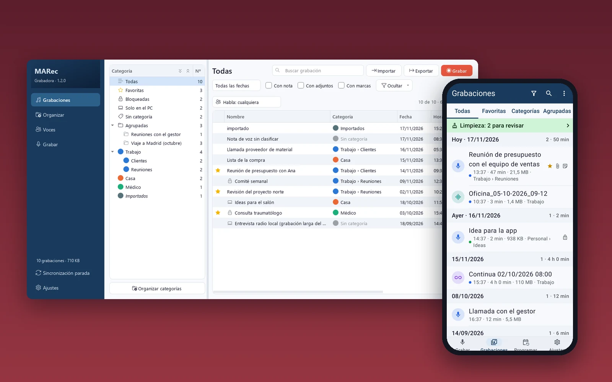

**Funcionan juntas.** El PC hace de servidor y el móvil se sincroniza con él por la Wi-Fi, en los dos sentidos: emparejados con un código QR y cifrado, sin cuentas ni nube. Cada una funciona también sola.

## Windows 1.2.0

**Windows 10 / 11 · 64 bits** · [Página de la versión](https://github.com/MaSoft/MARec/releases/tag/escritorio-v1.2.0)

- **Instalador:** [`MARec_Escritorio_Setup_v1.2.0.exe`](https://github.com/MaSoft/MARec/releases/download/escritorio-v1.2.0/MARec_Escritorio_Setup_v1.2.0.exe) · 167,9 MB · SHA-256 `fe31a6a8fd11b8ad4132928e572de82500e1e3d58f571a10a364133a7924f336`
- **Ejecutable único (sin instalar):** [`MARec_v1.2.0.exe`](https://github.com/MaSoft/MARec/releases/download/escritorio-v1.2.0/MARec_v1.2.0.exe) · 256,7 MB · SHA-256 `d0f3439d5b2ce790754d47b6dc76df0226bddcd4db50bd99a20f322a4f54c968`

### Qué hace
- Biblioteca de grabaciones con árbol de categorías y subcategorías, favoritas, bloqueadas y «Sin categoría».
- Organizar a dos columnas: una categoría a cada lado, se mueven grabaciones con flechas o arrastrando.
- Reproductor con forma de onda y marcas; las partes de una grabación se oyen seguidas. Marcas, nota y adjuntos.
- Voces y texto: separa quién habla, pone el nombre de cada persona y transcribe lo que dice. En el PC, sin internet.
- Buscar lo que se dijo: el buscador encuentra las palabras de las transcripciones y la página Voces enseña lo que dice cada persona.
- Transcripción a Word, PDF, texto y página web; las palabras dudosas salen en gris para repasarlas.
- Editar el audio: quitar trozos, recortar, dividir y quitar silencios; guarda grabaciones nuevas y la original no se toca.
- Importar audios sueltos o carpetas y exportar a ZIP o carpeta, por categorías.
- Grabar con el micrófono del PC, con pausa, marcas y onda en vivo.
- Todo cifrado en tu PC; sincronización con el móvil por la Wi-Fi emparejando con un código QR.

### Requisitos

| | |
|---|---|
| Sistema | Windows 10 u 11 de 64 bits |
| Micrófono | Solo para grabar en el PC. |
| Red | Solo para sincronizar: el PC y el móvil en la misma red, puerto 47890 permitido en redes privadas. |
| Voces y texto | Procesador de 4 núcleos o más, 8 GB de memoria y 3,1 GB de disco. Internet solo una vez, para descargar los modelos. |
| Instalación | Instalador para tu usuario, sin permisos de administrador, o ejecutable único que se copia y se abre; Python va dentro. |

### Capturas

| | |
|---|---|
| 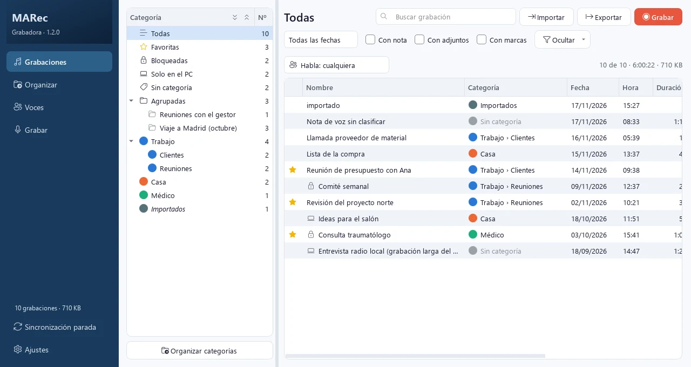 **Grabaciones.** Árbol de categorías, filtros y la tabla con todas las grabaciones. | 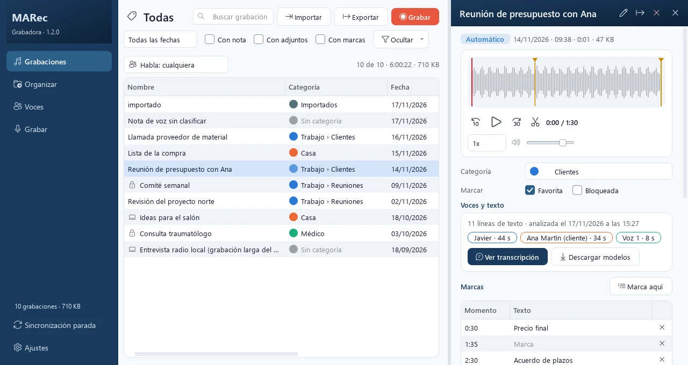 **Ficha.** Reproductor con onda y marcas, categoría, voces y texto. |
| 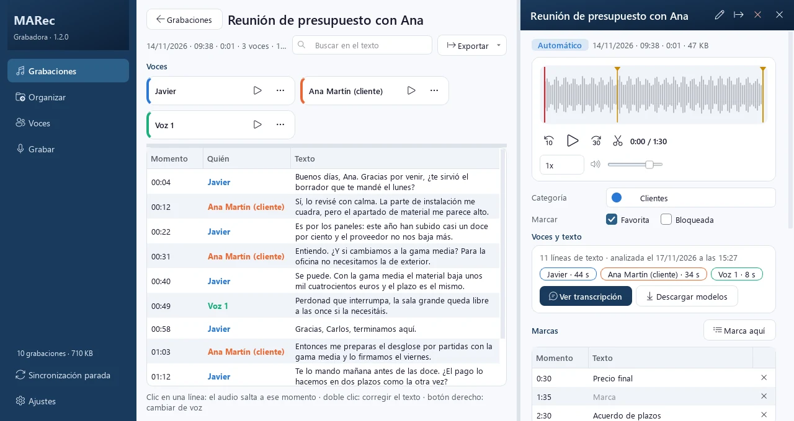 **Transcripción.** Cada frase con su momento y la persona que habla; clic y el audio salta ahí. | 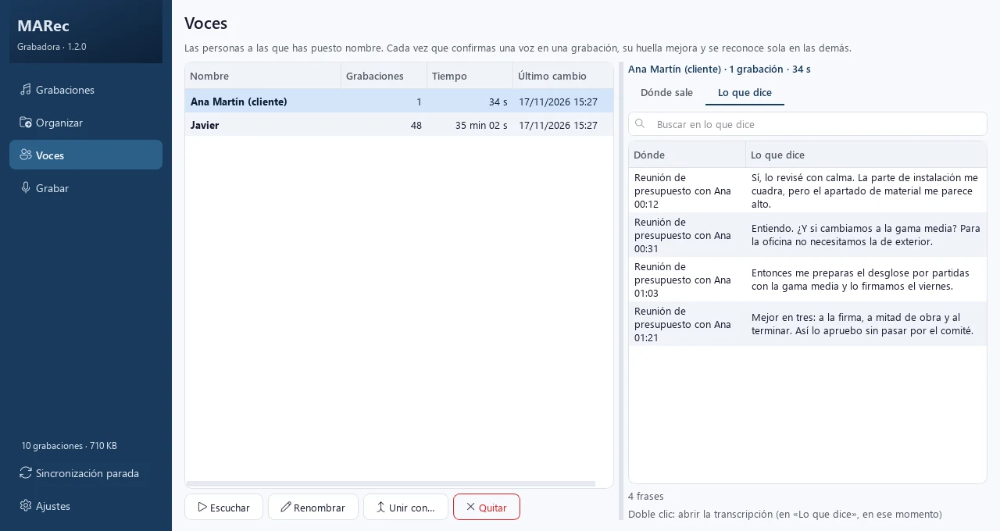 **Voces.** Las personas con nombre y todo lo que dice cada una. |
| 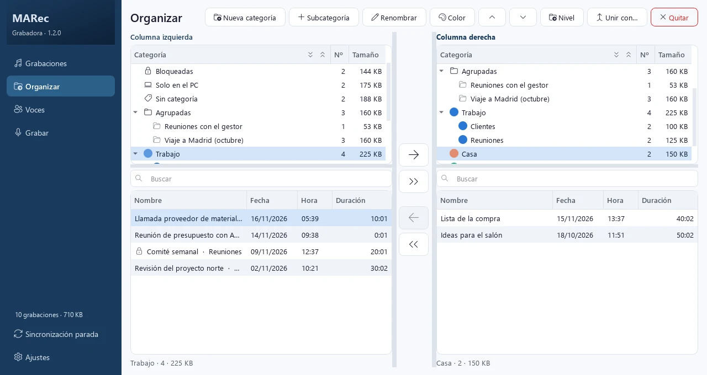 **Organizar.** Dos columnas para mover grabaciones y gestionar categorías. | 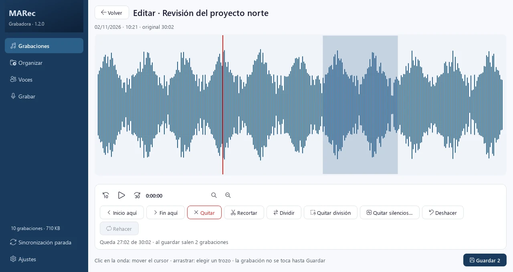 **Editar el audio.** Quitar, recortar, dividir y quitar silencios sin tocar la original. |

## Android 1.5.0

**Android 10 o superior · reloj Wear OS 3 o superior (opcional)** · [Página de la versión](https://github.com/MaSoft/MARec/releases/tag/android-v1.5.0)

- **APK:** [`MARec-1.5.0.apk`](https://github.com/MaSoft/MARec/releases/download/android-v1.5.0/MARec-1.5.0.apk) · 61,2 MB · SHA-256 `fedfdf6f2e6f52cc20cc7b5c53907ede397799cdeb8accc3930fa13e38cd5da9`
- **APK del reloj (Wear OS):** [`MARecClock-1.1.0.apk`](https://github.com/MaSoft/MARec/releases/download/reloj-v1.1.0/MARecClock-1.1.0.apk) · 2,6 MB · SHA-256 `5cf672ef68f94136ce3382dd5b73c9ccc37bebeb6336b53921962e75d39775a3`

### Qué hace
- Manual o Automático: graba al pulsar o solo cuando hay sonido por encima del umbral, sin perder los segundos de antes.
- Programaciones por franja horaria, días de la semana o fecha concreta, también de día completo o pasando la medianoche.
- En Automático, si el sonido vuelve tras una pausa sigue en la misma grabación, sin guardar el silencio.
- Categorías con color y subcategorías, favoritas, agrupaciones y búsqueda por nombre, nota o categoría.
- Marcas, nota y adjuntos (imágenes o documentos) en cada grabación.
- Reproductor con forma de onda, saltos de 10 s, velocidad y saltar silencios; editor para quitar, recortar, dividir y quitar silencios.
- Bloquear cifra la grabación y sus adjuntos; para borrarla hay que escribir BORRAR.
- Widget y botón en los ajustes rápidos para grabar sin abrir la app; Lugares que dan nombre y categoría a lo grabado allí.
- Limpieza que pregunta: propone las antiguas o las que pasan de un tamaño y tú eliges. Nunca borra sola.
- Sincronización con MARec del PC por la Wi-Fi, y «Quitar del móvil» lo que el PC ya tiene entero para liberar espacio.
- App para el reloj (MARecClock, Wear OS): graba en Detectando sonido o Continua; un toque pausa y dos paran, con una vibración corta como respuesta.
- Lo grabado en el reloj se guarda o se elimina allí mismo; al Guardar pasa al móvil, a «Grabaciones Reloj», y se borra del reloj solo cuando el móvil confirma que la tiene.

### Requisitos

| | |
|---|---|
| Sistema | Android 10 o superior |
| Permisos | Micrófono (imprescindible); avisos, alarmas exactas y sin ahorro de batería, recomendados para programar; ubicación solo para Lugares. |
| Internet | No hace falta: las grabaciones se quedan en el móvil y la sincronización va por la Wi-Fi de casa u oficina. |
| Instalación | Se descarga el APK en el móvil y se abre; Android pide permiso para instalar aplicaciones de esa fuente. |
| Actualizar | La versión nueva se instala encima de la anterior sin perder las grabaciones. |
| Reloj (opcional) | Wear OS 3 o superior, emparejado con el móvil que tiene MARec 1.5.0; sin el móvil no funciona. |
| Instalar en el reloj | No se instala tocando el archivo como en el móvil: se pasa desde el ordenador con la depuración inalámbrica del reloj (ADB). |

### Capturas

| | |
|---|---|
| 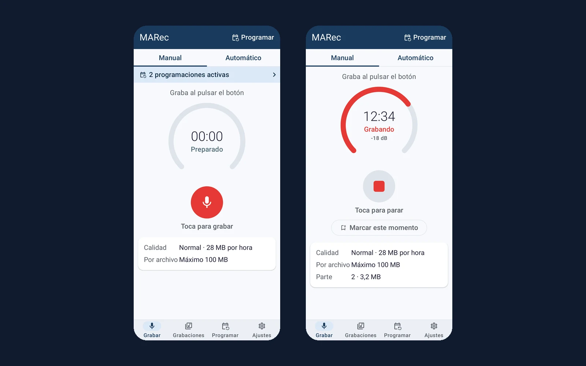 **Grabar.** Manual o Automático con su medidor de nivel, y grabando con marcas. | 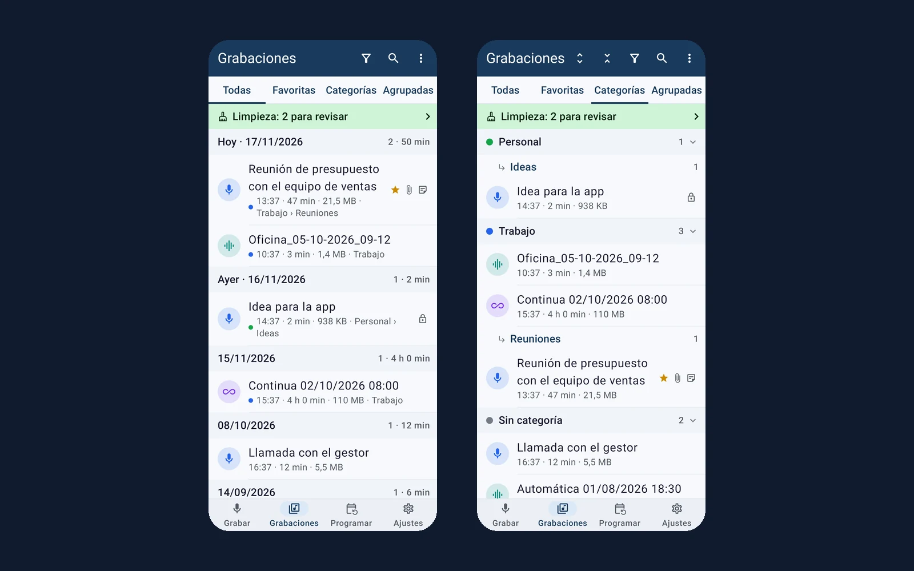 **Grabaciones.** Por días o por categorías, con favoritas, bloqueadas y adjuntos a la vista. |
| 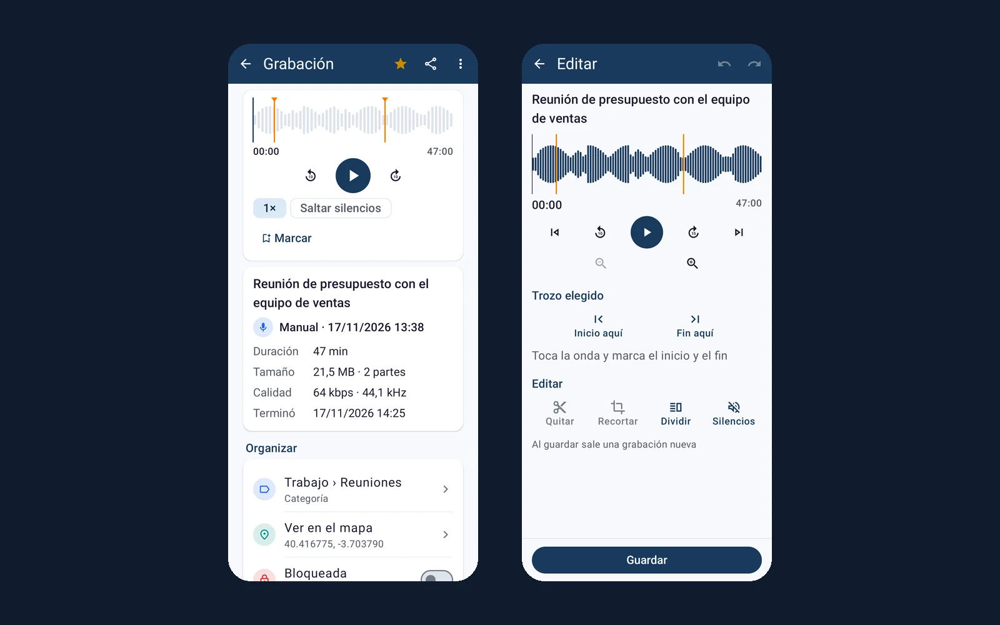 **Ficha y editor.** Reproductor con onda y marcas, nota y adjuntos; y el editor de audio. | 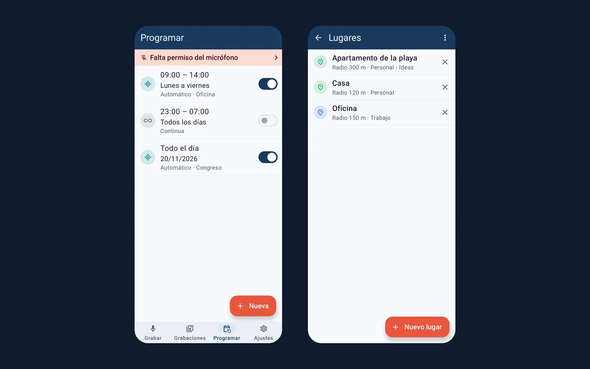 **Programar y Lugares.** Franjas por horas y días, y los lugares que dan nombre a lo grabado allí. |
| 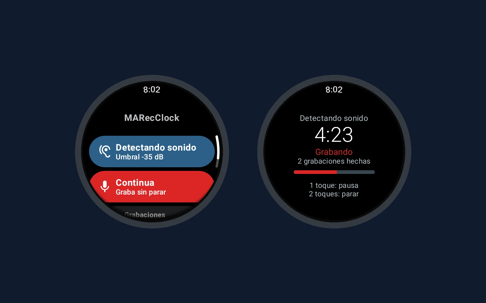 **Reloj: grabar.** MARecClock en el reloj: los dos modos y la grabación en marcha (un toque pausa, dos paran). | 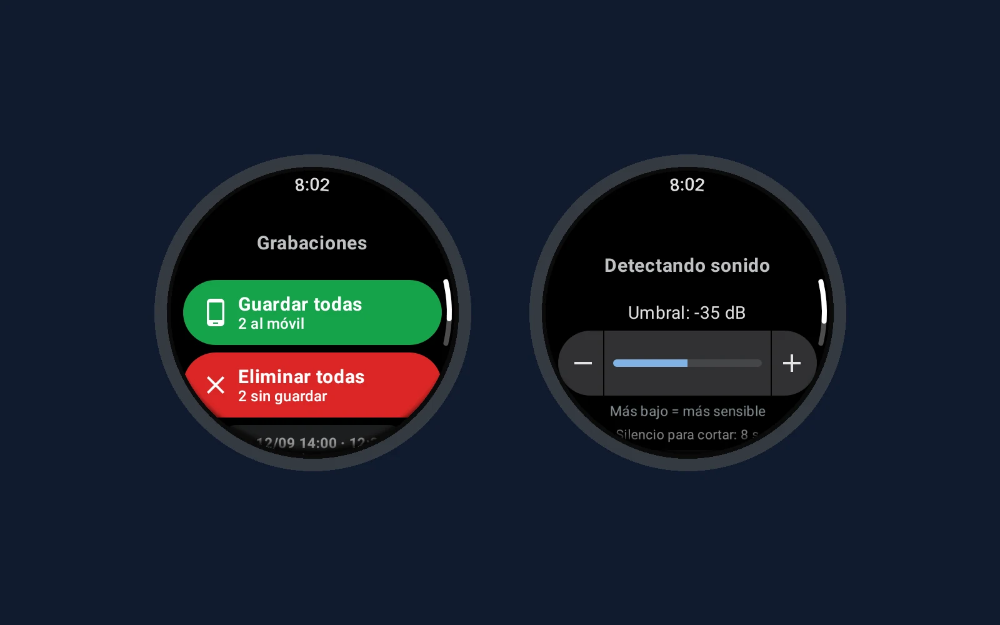 **Reloj: grabaciones y ajustes.** Guardar al móvil o eliminar lo grabado, y el umbral de Detectando sonido. |

## Instalación y comprobación

- **Windows:** el instalador y el ejecutable no están firmados digitalmente: Windows puede mostrar «Windows protegió su PC». Pulsa «Más información» y «Ejecutar de todas formas».
- **Android:** las aplicaciones no están en Google Play. Se descarga el APK en el móvil y se abre; Android pide permiso para instalar aplicaciones de esa fuente y Google Play Protect puede avisar de que no conoce la aplicación.
- **Reloj (Wear OS):** el APK del reloj no se instala tocándolo como en el móvil: se pasa desde el ordenador con la depuración inalámbrica del reloj (`adb pair`, `adb connect` y `adb install`). El reloj tiene que estar emparejado con el móvil que tiene MARec.

Para comprobar una descarga, en PowerShell `Get-FileHash .\<archivo>` debe dar la huella SHA-256 de arriba.

## Aviso legal

MARec es gratuito y se entrega tal cual, sin garantía de ningún tipo. Al descargarlo y usarlo aceptas el aviso legal y las limitaciones de su manual.

> ⚠ Grabar una conversación en la que participas es legal. Grabar a otras personas sin estar tú en la conversación ni tener su permiso puede ser delito (art. 197 del Código Penal). El modo Automático y la grabación continua programada pueden captar a cualquiera que hable cerca del móvil, y en el reloj Detectando sonido y Continua también: úsalos solo donde tengas derecho a grabar. Difundir una grabación también puede vulnerar derechos de las personas grabadas.
> ⚠ Voces y texto (PC): la huella de voz de una persona es un dato biométrico (RGPD, art. 9). Ponerle nombre a la voz de otra persona y guardarla requiere su consentimiento. La transcripción y los nombres son automáticos y pueden tener errores: no los uses como prueba sin escuchar el audio.

**Limitaciones y exclusión de responsabilidad**
- La responsabilidad del uso de las grabaciones es de quien las hace.
- Las grabaciones programadas dependen de que Android y el fabricante mantengan la app en marcha: no se garantiza que ninguna franja se grabe completa.
- En el móvil las grabaciones se guardan solo dentro de la app: si se desinstala o se borran sus datos, se pierden. Exporta antes lo que quieras conservar.
- En el PC los datos se guardan cifrados en este equipo: si se pierde la carpeta DATA o el usuario de Windows, no se pueden recuperar desde ahí (sí desde un móvil emparejado).
- El cifrado protege frente a quien copie los archivos, no frente a quien use el móvil desbloqueado o tu sesión de Windows abierta.
- El reloj (MARecClock) no funciona sin MARec en el móvil: las grabaciones se quedan en el reloj hasta que el móvil confirma que las tiene.
- MARec se proporciona tal cual, sin garantía de ningún tipo.

Este repositorio solo contiene las aplicaciones compiladas y su documentación. © Masoft.es. Todos los derechos reservados.
